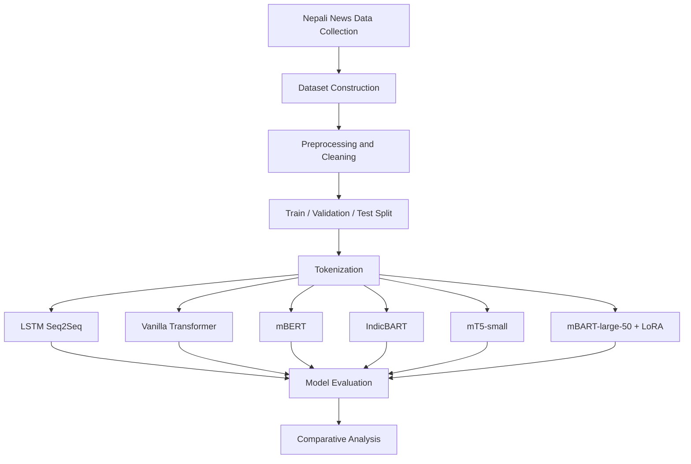

# Nepali Text Summarization: A Comparative Evaluation of Neural and Pretrained Models on Nepali News

<p align="center">
  
  
  
  
</p>

<p align="center">
  <strong>Advancing Nepali Natural Language Processing through Dataset Development and Comparative Evaluation of Neural and Multilingual Pretrained Models.</strong>
</p>

<p align="center">
  <a href="https://huggingface.co/datasets/Prasiddha573/Nepali_News_Summarization_Dataset">Dataset</a> •
  <a href="#research-overview">Research Overview</a> •
  <a href="#experimental-results">Experimental Results</a> •
  <a href="#repository-structure">Repository Structure</a> •
  <a href="#citation">Citation</a>
</p>

---

## Research Overview

Text summarization is an important Natural Language Processing (NLP) task that aims to generate concise representations of lengthy documents while preserving their essential information.

Despite significant advancements in neural architectures and multilingual pretrained language models, developing effective summarization systems for low-resource languages remains challenging due to limited language-specific datasets and computational resources.

This research presents a comparative evaluation of neural and multilingual pretrained models for **Nepali news text summarization**. It introduces a curated Nepali news summarization corpus and evaluates six model configurations under a common experimental framework.

The study investigates the performance of recurrent neural networks, Transformer architectures, and multilingual pretrained models using multiple automatic evaluation metrics.

### Key Contributions

- **Dataset Development:** Construction of a Nepali news summarization corpus containing 50,529 article-summary pairs.
- **Original Data Collection:** Collection of 6,297 additional Nepali news articles through a Python-based web scraping pipeline, followed by manual review by the authors.
- **Comparative Evaluation:** Experimental comparison of six neural and multilingual pretrained model configurations.
- **Custom Tokenization:** Development of separate SentencePiece Unigram and Byte Pair Encoding (BPE) tokenizers for the custom LSTM and Transformer architectures.
- **Parameter-Efficient Fine-Tuning:** Application of Low-Rank Adaptation (LoRA) to mBART-large-50.
- **Multi-Metric Evaluation:** Assessment using SacreBLEU, ROUGE-1, ROUGE-2, ROUGE-L, Jaccard similarity, and BERTScore.

## Dataset

The research uses a combined Nepali news summarization corpus constructed from publicly available datasets and additional news articles collected from Nepali digital news portals.

### Dataset Composition

The initial corpus contained 60,122 article-summary pairs. Following preprocessing, including the removal of missing records, duplicate content, and advertisements, the final dataset contained **50,529 article-summary pairs**.

| Dataset Source | Number of Samples |
|---|---:|
| iNLTK Nepali News Dataset | 7,465 |
| Nepali News Article with Summary | 5,022 |
| Nepali News Summary Dataset | 41,338 |
| Additional Web-Scraped Articles | 6,297 |
| Final Processed Dataset | **50,529** |

*Note: The original datasets were combined and subsequently processed. The final corpus contains 44,232 instances from publicly available resources and 6,297 additional scraped instances.*

### Dataset Distribution

The final dataset follows an 80:10:10 training, validation, and testing split.

| Dataset Split | Samples | Percentage |
|---|---:|---:|
| Training | 40,423 | 80% |
| Validation | 5,053 | 10% |
| Testing | 5,053 | 10% |
| **Total** | **50,529** | **100%** |

The same data split, generated using a fixed random seed of 42, was maintained across the model experiments.

### Dataset Statistics

| Statistic | Articles | Summaries |
|---|---:|---:|
| Mean Length (words) | 362.70 | 56.39 |
| Standard Deviation | 333.49 | 15.76 |
| Minimum Length | 24 | 8 |
| Median Length | 247 | 57 |
| Maximum Length | 6,094 | 145 |

### Dataset Access

The dataset is hosted on Hugging Face.

**Dataset Repository:**  
https://huggingface.co/datasets/Prasiddha573/Nepali_News_Summarization_Dataset

For dataset access, availability, or research-related inquiries, please contact:

**Email:** timalsinaprassiddha2016@gmail.com

Please mention your research purpose when requesting access.

The dataset is not included directly in this GitHub repository.

## Methodology

The research follows a systematic experimental workflow involving data collection, corpus construction, preprocessing, tokenization, model training, and evaluation.

### Research Workflow



### Model Architectures

Six model configurations were implemented and evaluated.

| Model | Description |
|---|---|
| LSTM Seq2Seq | Two-layer encoder-decoder LSTM with attention |
| Vanilla Transformer | Custom four-layer encoder-decoder Transformer |
| mBERT | Multilingual BERT adapted for sequence generation using BERT2BERT |
| IndicBART | Pretrained sequence-to-sequence model for Indic languages |
| mT5-small | Multilingual text-to-text Transformer |
| mBART-large-50 + LoRA | Multilingual sequence-to-sequence model fine-tuned using Low-Rank Adaptation |

### Tokenization

Different tokenization strategies were adopted according to the model architectures.

- **LSTM:** Custom SentencePiece Unigram tokenizer.
- **Vanilla Transformer:** Custom SentencePiece BPE tokenizer.
- **Pretrained Models:** Original model-specific tokenizers.

Both custom tokenizers use a vocabulary size of 32,000 and are trained using the training split.

### Training Configuration

| Configuration | Custom LSTM / Transformer | Pretrained Models |
|---|---|---|
| Optimizer | Adam | Adam |
| Learning Rate | 1 × 10⁻³ | 5 × 10⁻⁵ |
| Batch Size | 32 | 8 |
| Training Epochs | 30 | 3 |
| Gradient Clipping | 1.0 | As configured |
| Hardware | NVIDIA Tesla T4 GPUs | NVIDIA Tesla T4 GPUs |

For mBART-large-50, LoRA was configured with rank 8, scaling factor 32, and dropout 0.1.

This configuration trains 1,179,648 parameters out of 612,059,136 total parameters, approximately 0.19%.

## Experimental Results

The models were evaluated using six automatic evaluation metrics on the held-out test dataset.

### Comparative Performance

| Model | SacreBLEU | Jaccard | ROUGE-1 | ROUGE-2 | ROUGE-L | BERTScore F1 |
|---|---:|---:|---:|---:|---:|---:|
| LSTM | 7.1501 | 0.1870 | 0.2703 | 0.1025 | 0.2294 | 0.7784 |
| Vanilla Transformer | 19.8731 | **0.3100** | 0.4185 | **0.2449** | **0.3593** | 0.7887 |
| mBERT | 18.3007 | 0.1996 | 0.3019 | 0.1360 | 0.2444 | 0.7697 |
| IndicBART | 29.7576 | 0.2629 | 0.3910 | 0.2162 | 0.3246 | 0.7835 |
| mT5-small | **32.6487** | 0.2877 | 0.4162 | 0.2377 | 0.3509 | 0.7912 |
| mBART-large-50 + LoRA | 32.4750 | 0.2878 | **0.4199** | 0.2352 | 0.3476 | **0.7948** |

### Best Results by Evaluation Metric

| Evaluation Metric | Best Performing Model | Score |
|---|---|---:|
| SacreBLEU | mT5-small | 32.6487 |
| Jaccard Similarity | Vanilla Transformer | 0.3100 |
| ROUGE-1 | mBART-large-50 + LoRA | 0.4199 |
| ROUGE-2 | Vanilla Transformer | 0.2449 |
| ROUGE-L | Vanilla Transformer | 0.3593 |
| BERTScore F1 | mBART-large-50 + LoRA | 0.7948 |

### Key Findings

The experimental findings demonstrate that model performance varies across evaluation metrics.

- **mT5-small** achieved the highest SacreBLEU score of 32.6487.
- **Vanilla Transformer** achieved the highest Jaccard similarity, ROUGE-2, and ROUGE-L scores.
- **mBART-large-50 + LoRA** achieved the highest ROUGE-1 and BERTScore F1 scores.
- The custom Transformer demonstrated competitive performance compared with several multilingual pretrained models.
- Qualitative inspection identified issues such as information omission, repetition, and potentially unsupported information in selected generated summaries.

These findings highlight the importance of evaluating text summarization systems using multiple complementary metrics rather than relying on a single evaluation measure.

## Evaluation Metrics

The study employs the following evaluation metrics:

| Metric | Purpose |
|---|---|
| SacreBLEU | Measures standardized n-gram precision |
| ROUGE-1 | Measures unigram overlap |
| ROUGE-2 | Measures bigram overlap |
| ROUGE-L | Measures longest common subsequence overlap |
| Jaccard Similarity | Measures word-level set similarity |
| BERTScore F1 | Measures contextual semantic similarity |

## Repository Structure

```text
Nepali-Text-Summarization/
│
├── Data Scraping/
│   └── Data collection and scraping resources
│
├── indicbart-pipeline.ipynb
├── lstm-pipeline.ipynb
├── mbart-lora-pipeline.ipynb
├── mbert-pipeline.ipynb
├── mt5-pipeline.ipynb
├── transformer-pipeline.ipynb
│
└── README.md
```

Each notebook contains the corresponding model pipeline and experimental implementation.

The `Data Scraping` directory contains resources associated with the additional news data collection process.

## Technology Stack

The research uses the following technologies and frameworks:

- **Programming Language:** Python
- **Deep Learning:** PyTorch
- **NLP and Model Training:** Hugging Face Transformers
- **Tokenization:** SentencePiece
- **Data Processing:** Pandas, NumPy
- **Parameter-Efficient Fine-Tuning:** LoRA
- **Evaluation:** SacreBLEU, ROUGE, Jaccard Similarity, BERTScore
- **Experimental Environment:** Kaggle with NVIDIA Tesla T4 GPUs

## Research Limitations and Future Directions

Although this study provides a comparative evaluation of six model configurations, several limitations remain.

1. Some reference summaries in the scraped dataset were heuristically constructed using article titles and salient lead sentences rather than independently written and verified summaries.
2. Potential near-duplicate news articles may remain across dataset splits.
3. Automatic evaluation metrics cannot fully assess factual consistency, information completeness, and grammatical fluency.
4. Qualitative evaluation was based on selected outputs inspected by native Nepali-speaking authors rather than a standardized human evaluation protocol.
5. Differences in model architectures, tokenization strategies, sequence lengths, and optimization configurations should be considered when interpreting comparative results.

Future research directions include:

- Developing a larger collection of independently verified human-written summaries.
- Conducting structured human evaluations.
- Improving factual consistency and hallucination detection.
- Investigating domain adaptation and Nepali-specific pretrained models.
- Exploring instruction-tuned multilingual large language models.
- Comparing parameter-efficient fine-tuning with full-model fine-tuning.

## Research Team

**Information and Language Processing Research Lab (ILPRL)**  
Department of Computer Science and Engineering  
Kathmandu University, Dhulikhel, Nepal.

### Authors

- **Siddhant Timalsina**
- **Prasiddha Timalsina**
- Bipesh Subedi*
- Bal Krishna Bal*

*Corresponding Authors

## Acknowledgements

We would like to express our gratitude to the Information and Language Processing Research Lab (ILPRL), Department of Computer Science and Engineering, Kathmandu University, for providing the research environment and institutional support that made this work possible.

## Citation

If you use this research, methodology, or its findings in your academic work, please cite the corresponding research paper.

**Title:** Nepali Text Summarization: A Comparative Evaluation of Neural and Pretrained Models on Nepali News

**Authors:** Siddhant Timalsina, Prasiddha Timalsina, Bipesh Subedi, and Bal Krishna Bal.

*Publication details and DOI will be added following publication.*

## Contact

For research collaboration, technical questions, or dataset-related inquiries:

- **Dataset Contact:** timalsinaprassiddha2016@gmail.com
- **Research Contact:** siddhanttimalsina10@gmail.com
- **GitHub:** https://github.com/ANONYMOUS-SIDD

---

<p align="center">
  <strong>Contributing to Nepali Language Technology and Low-Resource NLP Research.</strong>
  <br/>
  <sub>Developed at Information and Language Processing Research Lab, Kathmandu University.</sub>
</p>
